I build web products end to end, train the occasional CNN, and write about what broke along the way. Final year of B.Tech CS (AI & ML) at Graphic Era Hill University, class of 2027, and open to internships and full-time roles in full-stack or ML engineering.

[kamaldhami.in](https://kamaldhami.in) · [LinkedIn](https://www.linkedin.com/in/kamal-singh-dhami/) · [devdhami765@gmail.com](mailto:devdhami765@gmail.com)

[Projects](#things-ive-built) · [Activity](#activity) · [Outside my own repos](#outside-my-own-repos) · [Writing](#writing) · [Stack](#stack)

## Things I've built

Prepology is live at [prepology.kamaldhami.in](https://prepology.kamaldhami.in); its source is private for now. Link-UP is live at [link-up.kamaldhami.in](https://link-up.kamaldhami.in).

Also on the shelf: [PixelShrink](https://github.com/KamalSDhami/PixelShrink), a drag-and-drop batch image compressor with background removal (Python, PySide6). A [tomato leaf disease](https://github.com/KamalSDhami/Tomato-Leaf-Disease-Detection) benchmark of VGG16, DenseNet121, InceptionV3, Xception and MobileNetV2 on 29K images, where VGG16 won at 96.6%. A [LangChain](https://github.com/KamalSDhami/LangChain) notebook, [Transformers](https://github.com/KamalSDhami/Transformers) experiments, a monitoring UI for [agent squads](https://github.com/KamalSDhami/AgentCrab), and a pile of lab work.

## Activity

<!-- ACTIVITY:START -->

Recently pushed: kamaldhami (private) · prepology (private) · [LangChain](https://github.com/KamalSDhami/LangChain) · [alrlEEna-2026](https://github.com/KamalSDhami/alrlEEna-2026) · [Compiler_Lab](https://github.com/KamalSDhami/Compiler_Lab) · [Transformers](https://github.com/KamalSDhami/Transformers). Redrawn every six hours by a GitHub Action.
<!-- ACTIVITY:END -->

## Outside my own repos

<!-- CONTRIB:START -->
- **hemalbadola/baton** private Runs one LLM across several laptops on the same Wi-Fi, each holding a few layers and passing activations along like a relay baton. On PyPI as [baton-cluster](https://pypi.org/project/baton-cluster/). I'm the second-largest contributor: int8 and int4 quantized weights in the decoder, recovery when a laptop drops out of the ring, per-hop network timing for the planner, and the Windows installer and PyPI release pipeline.
<!-- CONTRIB:END -->

## Writing

- [Architecting Link-UP: Real-Time State, WebSocket Multiplexing, and Supabase RLS](https://kamaldhami.in/blog/building-secure-collaboration-platforms-with-react)
- [Pruning the DOM: How I Pushed WordPress Client Sites to 95+ Core Web Vitals](https://kamaldhami.in/blog/wordpress-optimization-tips-for-better-performance)
- [Plant Pathology at Scale: Benchmarking CNN Backbones on 29,000+ Leaf Images](https://kamaldhami.in/blog/deep-learning-with-cnns-practical-image-classification)
- [Building from the Foothills: From Dehradun to Full-Stack Production Systems](https://kamaldhami.in/blog/my-journey-from-uttarakhand-to-tech-development)

## Stack

- **Reach for daily:** TypeScript, React, Next.js, Python, Supabase/Postgres, Git.
- **Have shipped with:** Flutter and Dart, Hono, Drizzle, TensorFlow and Keras, Java and JavaFX, C and C++, WordPress, Docker, Cloudflare.
- **Currently learning:** agent environments and reinforcement learning, Linux internals, and how to write less code.

## Elsewhere

I did WordPress work at Code Buzz Web and web development at Doon Digital before this. Certifications from Google Cloud Arcade and NPTEL (Machine Learning, Large Language Models).

If something here is useful or wrong, [open an issue](https://github.com/KamalSDhami/KamalSDhami/issues) or send an email.
